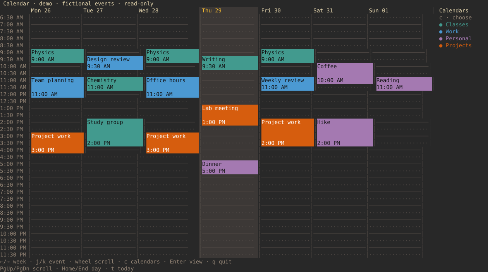

# calendar-tui

[](https://github.com/maxlang7/calendar-tui/actions/workflows/ci.yml)
[](LICENSE)

A compact Google Calendar week view for your terminal, written in Rust with Ratatui. Browse a local cache, choose which calendars to show, and edit events without opening a browser.



*The preview uses the built-in read-only demo. No personal calendar data is included.*

## Try it

With a recent stable Rust toolchain installed:

```sh
git clone https://github.com/maxlang7/calendar-tui.git
cd calendar-tui
cargo run --locked -- --demo
```

The demo needs no credentials, makes no network requests, and writes no calendar or preference data. It shows a sample week with fictional events and lets you try navigation and calendar visibility.

To install the optimized binary:

```sh
cargo install --locked --path .
calendar-tui --demo
```

Developed and tested on Linux. The app uses Unix file permissions and is not currently a Windows application.

## What it does

- Seven-day grid with times down the left, overlapping events side by side, and all-day events above the grid.
- Compact header and right sidebar designed for ordinary windows, with rendering checks at 140×39, 100×28, and 80×24 terminal cells.
- Gruvbox interface, a lighter background for today, and event colors taken from Google Calendar when available.
- Mouse-wheel and keyboard scrolling through the full day, with 12-hour AM/PM labels and local-time editing.
- A rolling four-month cache, extending two calendar months before today and two months after it.
- Current-week sync every five minutes and full-cache sync hourly while the app is open. Cached events stay visible during network failures.
- Editable title, start, end, location, and description, with a review before saving.
- Deletion that requires typing `DELETE`, with recurring-event changes limited to the selected occurrence.

## Connect Google Calendar

The app uses one Google account per configuration and cache. It reads an existing **OAuth authorized-user JSON file** and refreshes access tokens in memory. It does not include an interactive sign-in flow, and it never rewrites your credentials file.

Set the credentials path explicitly:

```sh
export CALENDAR_TUI_CREDENTIALS="/path/to/authorized-user.json"
calendar-tui --sync-full
calendar-tui
```

If that variable is unset, the app checks `GOOGLE_APPLICATION_CREDENTIALS`, then `$XDG_CONFIG_HOME/calendar-tui/credentials.json`, defaulting to `~/.config/calendar-tui/credentials.json`.

The JSON must contain `client_id`, `client_secret`, and `refresh_token`. An OAuth client download or service-account key is not an authorized-user file. Existing access tokens with a valid `expiry` are also supported.

### Obtain credentials with gcloud

If you do not already have authorized-user credentials:

1. Enable the Google Calendar API in your Google Cloud project and create a Desktop app OAuth client. Configure the consent screen and add yourself as a test user if required.
2. Download the client JSON and use it to authorize your account:

   ```sh
   gcloud auth application-default login \
     --client-id-file=/path/to/client_secret.json \
     --scopes=https://www.googleapis.com/auth/calendar.events,https://www.googleapis.com/auth/calendar.calendarlist.readonly
   ```

3. Point the app at the authorized-user file generated by gcloud. On a default Linux installation:

   ```sh
   export CALENDAR_TUI_CREDENTIALS="$HOME/.config/gcloud/application_default_credentials.json"
   calendar-tui --sync-full
   ```

These scopes allow listing calendars and reading, editing, and deleting events. Read-only authorization can be used for browsing, but write operations will require sufficient Google permissions. See Google's [gcloud login reference](https://cloud.google.com/sdk/gcloud/reference/auth/application-default/login) and [Calendar scope guide](https://developers.google.com/workspace/calendar/api/auth) for setup details.

Only calendars that Google marks selected and not hidden are fetched. The app's visibility menu filters those calendars locally; it does not change their Google Calendar settings.

## Keys

### Week view

| Key | Action |
| --- | --- |
| `←` / `→` | Previous / next week within the cached range |
| `j` / `k`, `↓` / `↑` | Select the next / previous event |
| Mouse wheel | Scroll in half-hour steps |
| `Page Up` / `Page Down` | Scroll three hours |
| `Home` / `End` | Jump to midnight / the final hours of the day |
| `t` | Return to the current week |
| `r` | Force a full-cache sync |
| `c` | Open the calendar visibility menu |
| `Enter` | Open the selected event |
| `Delete` | Review deleting the selected event |
| `q`, `Esc`, `Ctrl+C` | Quit |

In the calendar menu, use `j` / `k` to select a calendar and `Space` or `Enter` to toggle it. `a` enables all, `n` disables all, and `Esc` closes the menu. Hidden calendars remain cached and synced, so re-enabling them is immediate.

### Event popup

| Key | Action |
| --- | --- |
| `Tab` / `Shift+Tab` | Move between fields |
| `←` / `→`, `Home` / `End` | Move the text cursor |
| `Ctrl+U` | Clear the current field |
| `Enter` | Next field, or a newline in the description |
| `Ctrl+S` | Review changes, then press `y` to save |
| `Ctrl+D` | Review deletion, then type `DELETE` and press `Enter` |
| `Esc` | Cancel the current confirmation or close the popup |

Timed events use `YYYY-MM-DD h:mm AM/PM`. All-day events use `YYYY-MM-DD`, with an **exclusive end date**. Read-only calendars show details without allowing edits. In long confirmations and read-only descriptions, `Page Up` and `Page Down` scroll the text.

Saves and deletions use the event's cached ETag to reject conflicts, then read the event back to verify the result. The app never automatically retries a mutation. Guest updates are requested with `sendUpdates=none`. Whole-series editing and deletion, creating new events, changing calendars, and attendee management are not implemented.

## Cache and background sync

| Command | Behavior |
| --- | --- |
| `calendar-tui` | Open the cache immediately; sync in the background when due |
| `calendar-tui --sync` | Refresh the current week if at least five minutes old, or the full range if at least an hour old |
| `calendar-tui --sync-full` | Force a full four-month refresh and exit |
| `calendar-tui --check` | Report cache counts, coverage, and errors without syncing |
| `calendar-tui --demo` | Open a read-only, offline sample week |

The current week is Monday through Sunday. A successful full refresh also refreshes the current week. The full window shifts with today's date, so the first sync after a date change refreshes the entire range.

The header shows the age of the last successful current-week and full-cache sync. If a calendar fetch fails, its existing cached events remain intact and the error stays visible. File locks serialize sync and mutation operations, while atomic writes let an open UI reload cache changes safely.

To keep syncing while the UI is closed, schedule `calendar-tui --sync` every five minutes with your preferred scheduler. The command decides when the hourly full refresh is due. No daemon or service is installed by this repository.

### Local files

| File | Default location |
| --- | --- |
| Event cache | `~/.cache/calendar-tui/events.json` |
| Visibility preferences | `~/.config/calendar-tui/preferences.json` |
| Optional default credentials | `~/.config/calendar-tui/credentials.json` |

`XDG_CACHE_HOME` and `XDG_CONFIG_HOME` override the base directories. Runtime directories are private and files are created with mode `0600`. The cache contains event descriptions and locations, so treat it as private calendar data. Use separate XDG directories when running different accounts; sharing one cache across accounts is not supported.

## Development

```sh
cargo check --locked
cargo test --locked
cargo clippy --locked --all-targets -- -D warnings
cargo run --locked -- --demo
```

Use the incremental development build while changing the UI, then `cargo run --locked --release` to check release behavior. No system rebuild is needed for a local preview. CI checks formatting, linting, tests, and the release build without Google credentials.

The README image is generated from the same terminal renderer using fictional demo events:

```sh
CALENDAR_TUI_RENDER_DOCS=docs/preview.svg cargo test render_readonly_demo
```

## License

[MIT](LICENSE).
